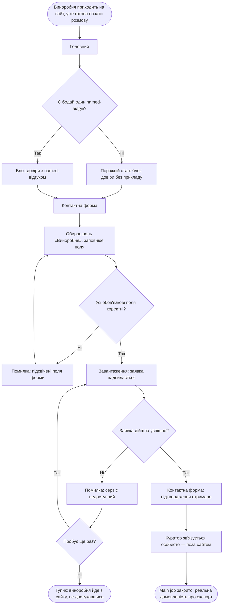
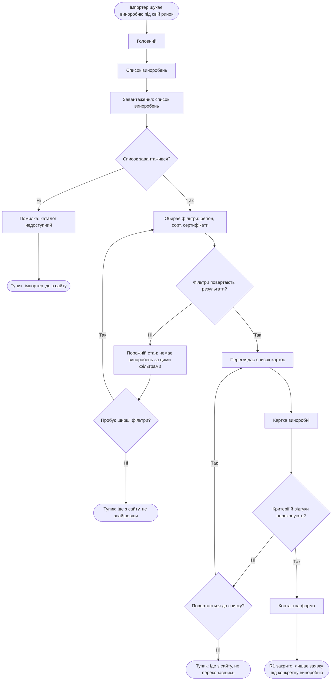
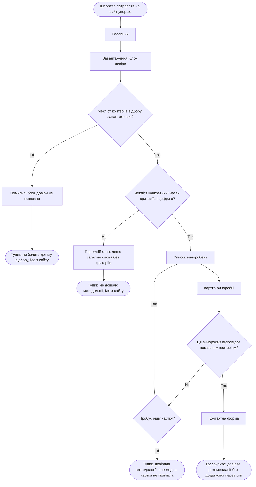

# User flows VH Selection

Mermaid `flowchart TD`. Кроки-екрани названі точно за `sitemap.md`
(розділ «Екрани»): `Головний`, `Список виноробень`, `Картка
виноробні`, `Контактна форма`. Жодного нового екрана тут не з'явилось
— увесь список нод, що НЕ екрани, це розвилки, стани чи стартові/
кінцеві маркери, не нові сторінки.

## Flow 1 — Main job: «Дійти до реальної домовленості про експорт через перевіреного партнера, не будуючи власний sales-процес»

Для Primary-персони (Виноробня без власного sales-ресурсу,
`personas.md`), у її задокументованих обставинах: вона приходить на
сайт уже готова почати розмову (`personas.md`, блок «Jobs» —
"Start the conversation"), не блукаючи каталогом (каталог — не її
сутність, `sitemap.md`, розділ «Сутності»).

**Розвилки:**
- `B` — Є бодай один named-відгук для показу на Головному.
- `G` — Усі обов'язкові поля форми заповнені коректно (хибне введення).
- `J` — Заявка дійшла успішно (дія/зовнішній сервіс могли не пройти).
- `L` — Виноробня пробує надіслати заявку ще раз після збою.

**Стани:**
- *Empty* — `C`: блок довіри без жодного named-відгуку (прямий ризик
  із `research.md`, ВИСНОВОК 7: ще немає партнера, готового дати
  цитату).
- *Error* — `H`: хибне введення (підсвічені поля); `K`: зовнішній
  сервіс не прийняв заявку.
- *Loading* — `I`: очікування під час надсилання заявки.
- *Тупик* — `M`: виноробня йде з сайту після повторного збою
  надсилання.
- *Успіх* — `N`→`O`→`P`: підтвердження отримано на сайті, далі процес
  веде куратор поза сайтом аж до самої угоди.

**Чесна межа:** вузол `P` — межа того, що відстежує сайт. Сутність
УГОДА (`sitemap.md`, розділ «Сутності») позначена `[?]` саме тому, що
результат Main job найімовірніше фіксується поза сайтом; `O`→`P` на
діаграмі — це перехід відповідальності, а не крок, що сайт реально
показує.

---

## Чому саме ці 2 related jobs

Обрано **R1** і **R2**, а не R3/R4:

- **R1** — найчастіший сценарій на сайті: це єдиний job, що передбачає
  повторюване, багаторазове переглядання (Secondary-персона гортає
  кілька карток), на відміну від одноразового R4.
- **R2** — найризикованіший: це вісь «Перевірені», яку весь ресерч
  (крок 05 БЕНЧМАРК) називає найслабшим місцем ринку — якщо вона не
  спрацює вже на Головному, людина йде з сайту, не дійшовши навіть до
  каталогу.
- **R4** не отримав окремого flow — він уже повністю показаний
  усередині Flow 1 (вузол `F`, вибір ролі — це і є відповідь на R4
  для Виноробні).
- **R3** не отримав окремого flow — він побудований на одному data
  point (`research/notes/personas-review.md`, ризик №2) і наразі не
  має власного відмінного входу на сайт (та сама Картка виноробні, що
  й у R1/R2); окремий flow для нього буде змістовнішим після
  вирішення ризику №2 з ресерчу, а не зараз.

---

## Flow 2 — R1: «Звузити вибір до реально підходящих партнерів»

Для Secondary-персони (Імпортер-дослідник каталогу, `personas.md`).

**Розвилки:**
- `D` — Список виноробень завантажився (дані можуть не прийти).
- `H` — Фільтри повертають результати (ризик порожнього каталогу).
- `J` — Імпортер пробує ширші фільтри після порожнього результату.
- `N` — Критерії й відгуки на картці переконують.
- `O` — Повертається до списку спробувати іншу виноробню.

**Стани:**
- *Error* — `E`: каталог технічно недоступний.
- *Loading* — `C`: очікування списку виноробень.
- *Empty* — `I`: фільтри повернули нуль результатів — прямий ризик із
  `research.md`, КАТАЛОГ → «Чого уникати» (гранулярні фільтри на
  малому каталозі).
- *Тупики* — `F` (технічний збій), `K` (нічого не знайшла навіть
  після розширення фільтрів), `P` (переглянула, не переконалась).
- *Успіх* — `Q`→`R`.

---

## Flow 3 — R2: «Зрозуміти, що партнера вже хтось перевірив»

Для обох Secondary-персон (`research/notes/jtbd.md`: job R2 явно
віднесено до обох). Зосереджено на першому, найкритичнішому
моменті — довірі до самої методології VH Selection ще до того, як
людина дійшла до конкретної картки.

**Розвилки:**
- `B` — Чекліст критеріїв відбору технічно завантажився.
- `E` — Чекліст конкретний (іменовані критерії й цифри, а не загальні
  слова) — пряма перевірка ризику з `research.md`, БЕНЧМАРК.
- `J` — Конкретна виноробня відповідає показаним критеріям.
- `K` — Пробує іншу картку після невдалої.

**Стани:**
- *Loading* — `A1`: очікування блоку довіри на Головному.
- *Error* — `C`: блок довіри технічно не показано.
- *Empty* — `F`: блок є, але без конкретики (слова на кшталт
  "trusted"/"curated" без цифр — найчастіший патерн конкурентів,
  `research.md`, КОНКУРЕНТИ, рядок «Перевірені»).
- *Тупики* — `D`, `G` (бере до того, як узагалі дійшла до каталогу),
  `L` (довіряла системі, але жодна конкретна картка не підійшла).
- *Успіх* — `M`→`N`.
